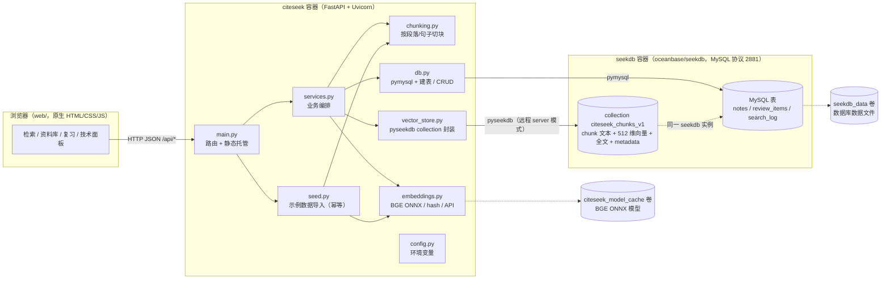
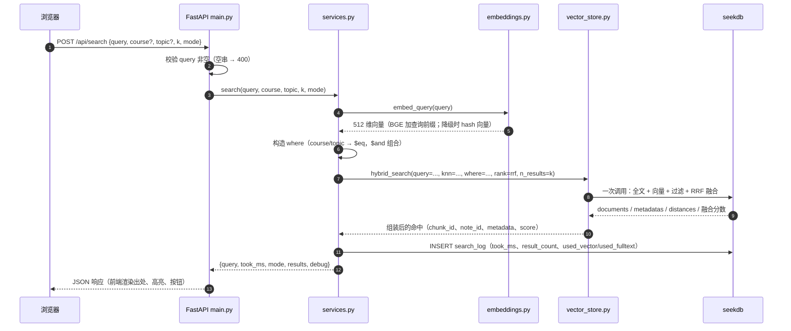

# CiteSeek 知源 · 架构说明（ARCHITECTURE）

> 依据 [DESIGN.md](DESIGN.md) v1 编写。若实现与本文有出入，以代码与 DESIGN.md 为准，差异记录在 `docs/DECISIONS.md`。
> 读者：评审 / 工程同学。目标：讲清**一次检索请求怎么走、seekdb 承担了什么、为什么这样设计**。
> 相关：[RUNBOOK.md](RUNBOOK.md)（启动）、[VERIFY.md](VERIFY.md)（验证样例）、[示例数据](../data/samples/README.md)。

## 1. 一句话架构

原生 JS 单页（无构建、无 CDN）→ FastAPI 服务编排 → 应用层算 embedding → 通过 pyseekdb 调用 seekdb 的 `hybrid_search`（向量 + 全文 + 结构化过滤一次完成，RRF 融合）→ 结果带出处返回；业务数据（笔记、复习进度、检索日志）落在 seekdb 的 MySQL 兼容表里。

## 2. 组件与部署拓扑



文字版（不依赖 Mermaid 渲染）：

```
浏览器(web/)
   │ HTTP JSON
   ▼
FastAPI(main.py) ──► services.py ──┬──► chunking.py
                                   ├──► embeddings.py ──► 模型缓存卷
                                   ├──► vector_store.py ──► seekdb: collection
                                   └──► db.py ──► seekdb: MySQL 表
```

**部署形态**（DESIGN §10）：`docker-compose.yml` 两个服务——

- `seekdb`：`oceanbase/seekdb:latest`，暴露 2881（MySQL 协议）/ 2886，数据存 named volume `seekdb_data`，healthcheck 为 `mysqladmin ping -h 127.0.0.1 -P 2881`；
- `citeseek`：由 `Dockerfile` 构建，暴露 8000，`SEEKDB_HOST=seekdb`，模型缓存挂 `citeseek_model_cache` 卷（`/root/.cache/citeseek`），`depends_on: seekdb`；自身 healthcheck 探活 `/api/health`；默认 `SEED_ON_START=1`，启动时自动导入示例数据（幂等；前端也可手动触发）；
- 应用启动时重试等待 seekdb（最多 60s）、建库建表、初始化 collection。

**模块职责**：

| 模块 | 职责 |
|---|---|
| `app/main.py` | FastAPI 路由、请求校验、静态文件托管、CORS（`*`，仅本地演示） |
| `app/config.py` | 读取环境变量与默认值（DESIGN §9） |
| `app/db.py` | pymysql 连接池、建表、`notes` / `review_items` / `search_log` CRUD |
| `app/embeddings.py` | `embed_documents` / `embed_query`：BGE ONNX 优先，hash 兜底，API 模式；query 前缀处理 |
| `app/vector_store.py` | collection 初始化、`upsert`、`hybrid_search`、按 `note_id` 删除、`refresh_index` |
| `app/chunking.py` | 按空行分段、贪心聚合到 `<=300` 字、相邻 chunk 重叠 `<=50` 字（Markdown 标题随所在段落进入 chunk；上限仍满足 DESIGN 的 `<=400` 字），27 篇示例实测约 62 个 chunk |
| `app/services.py` | 导入、检索、复习的业务编排；写入 `search_log` |
| `app/seed.py` | 扫描 `data/samples/*.md`，解析 front-matter，按 title 幂等导入 |

## 3. 请求链路：一次搜索请求如何走过



按 DESIGN §5 的分步说明：

1. **参数校验**：`query` 为空 → HTTP 400；`k` 默认 8，`mode` 默认 `hybrid`。
2. **查询向量**：`embeddings.embed_query(query)`。BGE 中文模型要求给 query 加前缀 `为这个句子生成表示以用于检索相关文章：`，入库 document **不加**（见 §6）。
3. **构造过滤**：`course` / `topic` 非空时组成 `{"course": {"$eq": ...}}`，多个条件用 `$and` 组合；同一个 `where` 同时传给全文与向量两路。
4. **一次混合检索**：`collection.hybrid_search(...)`
   - 全文一路：`query={"where_document": {"$contains": query}, "where": where or None, "n_results": max(k*4, 20)}`；`$contains` 为空字符串时省略 `where_document`；
   - 向量一路：`knn={"query_embeddings": [query_vec], "where": where or None, "n_results": max(k*4, 20)}`；
   - 融合：`rank={"rrf": {"rank_window_size": 60, "rank_constant": 60}}`；
   - 输出：`n_results=k`，`include=["documents", "metadatas", "distances"]`。
5. **seekdb 内部**：全文倒排索引与向量 HNSW 索引各自召回，引擎内做 RRF 融合，并按 metadata 过滤；整个过程在**一次引擎调用**里完成，避免跨系统同步与二次排序。
6. **结果组装**：`chunk_id / note_id / title / course / topic / tags / text / score / distance / matched_by`；当前实现正常路径把每个结果统一标记为 `["vector","fulltext"]`（表示两路参与融合，**不是**字面命中判断）；`score` 正常路径为 `1/distance`、降级路径为 RRF 分数；高亮由前端完成。
7. **写日志**：`search_log` 记录 `took_ms`、`result_count`、`used_vector`、`used_fulltext`（技术面板与 VERIFY 的证据来源）。
8. **返回**：`{"query", "took_ms", "mode", "results", "debug"}`。

**失败降级路径**：若 `hybrid_search` 抛错（旧版引擎不支持），降级为「向量 `query` 一路 + 全文 `get(where_document={"$contains": ...})` 一路」，在应用层用 RRF 融合，并在响应的 `debug.degraded` 标记 `true`；结果结构与正常路径一致。

**索引刷新**：`refresh_index()` 在每次批量导入 / 删除后调用一次（seekdb 向量索引异步构建，不刷新可能查不到新数据）；检索接口本身不强制刷新（DESIGN §5）。

## 4. seekdb 中 collection 与 MySQL 表的职责划分

两类存储跑在**同一个 seekdb 实例**里，但职责严格分开：

| 维度 | collection `citeseek_chunks_v1` | MySQL 表 `notes` / `review_items` / `search_log` |
|---|---|---|
| 存什么 | chunk 文本、512 维向量、全文索引、metadata（`note_id`/`title`/`course`/`topic`/`tags`/`source`/`created_day`/`seq`） | `notes`：笔记原文与元数据、`chunk_count`；`review_items`：SM-2 状态；`search_log`：检索日志 |
| 面向的查询 | 「按语义 + 关键词召回片段」，带 `where` 结构化过滤和 RRF 融合排序 | 资料库列表 / 详情、今日待复习联表、技术面板统计（`due_at` 有 `idx_due` 索引） |
| 粒度 | chunk（检索单元；实现目标 `<=300` 字、上限 `<=400` 字） | note / 复习条目 / 单次检索 |
| 为什么放这里 | 向量 + 全文 + 过滤在同一引擎内一次完成，正是 seekdb 的价值 | 需要事务、主键/唯一键、联表、时间范围索引与聚合统计 |
| 关联键 | `note_id`（对应 `notes.id`）、chunk id 用 `review_items.chunk_id` 关联 | `review_items` 与 `notes` 联表取标题 / 课程 / 主题 |

**一致性设计**（不跨引擎事务，所以顺序设计成可重试）：

- **导入**：写 `notes` 表拿到 `note_id` → 切块 → 批量算 embedding → `collection.upsert` → 更新 `notes.chunk_count` → `refresh_index()`（当前实现为每篇写入后刷新，确保导入即可检索）。重复导入按 `title` 判重（幂等），不会产生重复 chunk。
- **删除**：`DELETE /api/notes/{id}` 同时删 collection 中该 note 的 chunks 与 `review_items`，避免孤儿数据；按「派生数据先删、主表后删」的顺序执行，失败可重试。
- **复习**：`review_items` 主键是 `chunk_id`（同一篇笔记的不同片段可分别复习），评分只更新该表，不触碰 collection。
- **检索日志**：`search_log` 只追加不更新，作为技术证据；重启后仍在，可支持 `top_queries` 统计。

**为什么不把复习状态塞进 collection metadata**：`due_at` 需要范围查询与索引、更新频繁，还要联表展示标题/课程；塞进向量库会变成高频元数据更新，且无法做 SQL 聚合。**为什么不把全文/向量检索放 MySQL**：那就要自己维护倒排与近似最近邻，失去 seekdb 的核心能力。

## 5. 为什么用 RRF（倒数排名融合）

- **两路分数不可直接比较**：向量一路是余弦相似度 / 距离（连续值，分布随 query 变化）；全文一路是 `$contains` 命中或 BM25 类分数（量纲完全不同）。加权求和需要归一化，权重和归一化方式都非常依赖经验。
- **RRF 只用名次**：`score(d) = Σᵢ 1 / (k + rankᵢ(d))`，`k=60`（`rank_constant`）。它天然规避量纲问题，对某一路的分数噪声鲁棒，几乎没有需要调的参数。
- **参数与实现一致**：DESIGN §5 规定 `rank_window_size=60`、`rank_constant=60`，候选窗口 `n_results=max(k*4, 20)` 保证两路都有足够候选再融合。
- **代价与缓解**：RRF 丢掉了分差信息（第 1 名和第 2 名差距被压平），长尾可能被拉平；本期演示场景可接受，后续可在应用层加 reranker 对 top-N 精排（§9）。
- **备选方案**：加权分数融合（需要标定两路分数量纲）、学习型融合（需要标注数据，本期非目标）。

## 6. 为什么 embedding 在应用层计算

DESIGN §4.1 明确 collection 的 `embedding_function=None`——嵌入一律由应用层计算并显式传入，原因：

1. **query 与 document 必须区别对待**：BGE 中文模型要求 query 加前缀 `为这个句子生成表示以用于检索相关文章：`，document 不加。这个语义只有应用层知道，引擎侧无法区分。
2. **四种模式可切换**：`auto / onnx / hash / api` 在应用层一个接口背后切换，collection 始终保持 512 维，**不需要重建索引**。
3. **降级可控**：模型下载失败或离线时退化为 hash 向量，仍能写入同一 collection，服务不中断（§7）。
4. **依赖隔离**：seekdb 容器保持轻量，不需要 Python / ONNX / 模型文件；模型缓存放在应用容器的 `citeseek_model_cache` 卷。
5. **模型版本可控**：换模型（尤其维度变化）需要新建 collection（名称已版本化为 `citeseek_chunks_v1`），由应用统一决定何时迁移。

**代价**：embedding 在 CPU 上推理，会增加检索耗时（短句毫秒级）与批量导入时间；通过批处理与合理的刷新时机控制。

## 7. 降级设计（三层）

| 层 | 触发条件 | 降级行为 | 可观测点 |
|---|---|---|---|
| ① 嵌入降级 | `EMBED_MODE=auto` 加载 ONNX 失败；`EMBED_MODE=onnx` 强制加载失败；`EMBED_MODE=api` 未配置 `EMBED_API_BASE` 或调用失败 | 退化为 hash（512 维字符 n-gram 哈希，确定、离线可用）；**全文关键词检索完整保留**，仅语义召回质量下降 | `/api/health` 的 `embed.mode=hash`、`embed.degraded=true` 及 `embed.reason` |
| ② 融合降级 | `hybrid_search` 抛错（旧版 seekdb 不支持混合检索） | 拆成「向量 `query` 一路 + 全文 `get($contains)` 一路」，应用层 RRF 融合；响应结构不变 | 响应 `debug.degraded=true` |
| ③ 存储 / 启动降级 | seekdb 尚未就绪 | 启动时最多 60s 重试，等待后建库建表、初始化 collection；运行期连接失败时接口报错并透出原因 | `/api/health` 的 `status`、`seekdb.connected`；启动日志 |

**设计原则**：

- **降级不静默**：必须通过 `degraded` / 原因 / 日志让评审知道当前处于哪种状态；
- **核心能力保留**：至少全文关键词 + 结构化过滤 + 复习/日志可用；向量只影响「换说法」的召回；
- **不承诺不存在的降级**：seekdb 不可用时检索/复习无法工作（存储强依赖），如实报错而不是返回空结果；
- 任何模式加载失败都兜底为 hash（当前实现），`degraded=true` 与 `embed.reason` 显式暴露；`EMBED_MODE=hash` 是主动选择，**不算降级**。

## 8. 写入链路：导入与删除

**导入（`POST /api/notes` 或 `POST /api/import/samples`）**：

1. 解析 front-matter（`title/course/topic/tags/source`）与正文；`title` 或 `content` 为空 → 400（批量导入时跳过重复 title）；
2. `notes` 表插入（`id`=uuid4 hex），得到 `note_id`；
3. `chunking.py` 按空行分段并贪心聚合到 `<=300` 字、相邻 chunk 重叠 `<=50` 字，记录 `seq`；
4. `embed_documents` 批量计算向量；
5. `collection.upsert(ids, documents, embeddings, metadatas)`，metadata 带 `note_id/title/course/topic/tags/source/created_day/seq`；
6. 更新 `notes.chunk_count`；
7. 每篇写入后调用 `refresh_index()`（当前实现逐篇刷新），让新 chunk 可被检索到。

**删除（`DELETE /api/notes/{id}`）**：

1. 从 collection 删除该 `note_id` 的全部 chunk；
2. 删除该 note 的 `review_items`；
3. 删除 `notes` 行；
4. `refresh_index()`。

顺序上先删派生数据、后删主表，任一步失败可安全重试（幂等）。

## 9. 可扩展点

- **精排**：在 hybrid top-N 上加 bge-reranker 类模型做交叉编码精排（应用层，不动 collection）。
- **过滤能力扩展**：`created_day` 时间范围、`tags` 包含、`source` 过滤——metadata 已预留这些字段。
- **索引 / 模型升级**：collection 名称版本化（`v2`），换 1024 维模型时新建 collection + 重建索引；旧集合可并行保留用于对比。
- **增量导入**：按「标题 + 内容 hash」判重，减少重复导入；支持 Markdown/TXT 文件上传（DESIGN §12 非目标里只排除了 PDF/Word 二进制解析）。
- **评估体系**：用 `data/samples/` 构造 `recall@k`、`MRR` 小基准，把 VERIFY 的三组命令脚本化，回归时自动跑。
- **生成式问答（带引用）**：RAG 式回答，必须单开关控制（DESIGN §12 明确本期非目标）。
- **多用户 / 权限**：当前单用户本地演示；扩展时需要给 `notes/review_items/search_log` 加用户维度并隔离 collection 或 metadata。
- **性能**：query 向量短时缓存、`pymysql` 连接池、批量 upsert、`refresh_index` 批量化、前端失败重试。
- **部署**：反向代理 + HTTPS、收紧 CORS（当前 `*` 仅为本地演示方便）。

## 10. 设计假设与边界

- collection 名称 `citeseek_chunks_v1`、维度 **512**、距离 **cosine**、HNSW 索引（DESIGN §4.1）；
- chunk 上限 `<= 400` 字（DESIGN §4.1），当前实现以 `<=300` 字为目标、相邻 chunk 重叠 `<=50` 字；示例数据每篇 150–400 字，27 篇实测约 62 个 chunk（随切块参数浮动；DESIGN 验收要求 `>=60`）；
- 单实例部署（uvicorn 单进程）、无鉴权、无多用户隔离；数据规模为千级 chunk 的演示场景；
- seekdb 向量索引异步构建，因此「导入后必须 `refresh_index()`」是正确性依赖；
- MySQL 表结构、字段名以 DESIGN §4.2 为准；API 契约以 DESIGN §7 为准；
- 本文为说明性架构文档，不替代代码注释；实现如有偏离，以 `docs/DECISIONS.md` 记录为准。