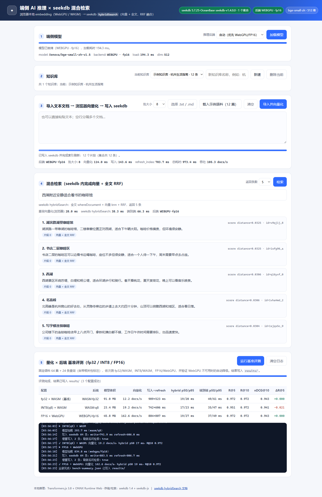

# 端侧 AI 推理 × seekdb 混合检索（迷你知识库）

这是 2026 数据库大赛「seekdb × 阶跃星辰」赛题（平台题目 **600073**）的参赛作品：

> 构建一个在浏览器本地完成向量化、使用 seekdb 进行语义与混合检索的迷你知识库应用。

所有 embedding **都在浏览器本地计算**（Transformers.js 3.8 + ONNX Runtime Web，优先 WebGPU，失败自动降级 WASM），
seekdb 只负责**存储**和**在库内完成向量 + 全文混合检索**（`hybridSearch`，RRF 融合）。没有任何云端推理调用。



## 1. 功能一览

| 能力 | 说明 |
| --- | --- |
| 文本导入 | 粘贴文本、选择 `.txt/.md` 文件、或一键载入 12 篇示例语料；按 240 字 / 60 字重叠切分 |
| 浏览器本地向量化 | Transformers.js `feature-extraction`，`bge-small-zh-v1.5`（512 维，中文），批量大小可调（1/8/16/32） |
| 写入 seekdb | 通过 `seekdb-js` 把向量、原文、元数据写入集合；写完调用 `refresh_index()`，新文档立即可检索 |
| 混合检索 | 浏览器算查询向量 → 服务端调用一次 `collection.hybridSearch({ query: { whereDocument }, knn: { queryEmbeddings }, rank: { rrf: {} } })`，融合在 seekdb 内完成 |
| 后端选择与降级 | 优先 WebGPU + FP16；`navigator.gpu` 不可用或初始化失败时自动降级 WASM + INT8(q8)，界面明确显示当前后端 |
| 知识库管理 | 一个知识库对应一个 seekdb 集合；支持新建 / 删除 / 切换，当前知识库保存在 `localStorage` |
| 增量导入 | `upsert` 按内容哈希去重，重复导入不产生重复记录；刷新索引后新增内容可检索 |
| 量化 × 后端评测 | 固定 64 篇中文语料 + 24 条带相关性标注的查询，依次测 fp32/WASM、INT8/WASM、FP16/WebGPU，输出体积、压缩比、吞吐、延迟、Recall@K / nDCG@K，结果写入 `results/` |

## 2. 架构

```
┌──────────────────────────── Chrome / Edge (用户设备) ────────────────────────────┐
│  前端（app/public）                                                              │
│   ├─ Transformers.js 3.8 + ONNX Runtime Web                                      │
│   │    ├─ device: webgpu + fp16（首选，检测 shader-f16）                          │
│   │    └─ device: wasm  + q8（自动降级，界面提示）                                │
│   └─ fetch → 本地 Node 服务（同机 127.0.0.1:3000）                                │
└───────────────────────────────────┬──────────────────────────────────────────────┘
                                    │ 只传「浏览器算好的向量 + 原文 + 元数据」/ 查询向量
                                    ▼
                     ┌────────────────────────────────────┐
                     │ app/server.mjs（Node 20+，Express） │
                     │  seekdb-js 1.4（server 模式）       │
                     └────────────────┬───────────────────┘
                                      ▼
                     ┌────────────────────────────────────┐
                     │ seekdb 1.4（Docker，127.0.0.1:2881）│
                     │  集合 = 全文索引(ik) + HNSW 向量索引 │
                     │  hybridSearch(query + knn + RRF)    │
                     └────────────────────────────────────┘
```

为什么需要一个本地 Node 服务：`seekdb-js` 是 Node 客户端，浏览器不能直连数据库；赛题也明确允许
「seekdb 使用嵌入式方式，或随应用提供本地 server 的启动脚本与连接配置」。本作品采用 **seekdb server 模式**
（Windows 不支持 seekdb-js 嵌入式模式）。

## 3. 快速开始

### 3.1 环境要求

- Node.js **20+**（实测 Node 24）
- Docker（运行 seekdb；或本机已有 seekdb server，改环境变量即可）
- Chrome / Edge 最新版（WebGPU 可选；不支持时自动用 WASM）

### 3.2 启动 seekdb

在**仓库根目录**执行：

```bash
cd stepfun
docker compose up -d          # 等价于 docker run -d --name seekdb-stepfun -p 2881:2881 oceanbase/seekdb
```

首次启动需要 1~2 分钟。确认就绪：

```bash
mysql -h127.0.0.1 -P2881 -uroot -e "SELECT VERSION();"
# 5.7.25-OceanBase seekdb-v1.4.0.0
```

> 默认使用 `test` 数据库；如需其他库，设置 `SEEKDB_DATABASE`（并先自行建库）。
> 若你当前已经在 `stepfun` 目录里，下面 3.3 的 `cd stepfun/app` 请改成 `cd app`。

### 3.3 安装依赖并启动应用

另开终端，在**仓库根目录**执行：

```bash
cd stepfun/app
npm install                   # .npmrc 里已带 legacy-peer-deps（见第 7 节说明）
node ../scripts/fetch-model.mjs   # 可选：预下载 3 种精度模型到 app/public/models（约 160 MB）
npm start                     # http://127.0.0.1:3000
```

可选的连通性自检（不需要浏览器/模型，只验证 seekdb + seekdb-js）：

```bash
npm run smoke                 # 建临时集合 → 写入 → hybridSearch → 删除，输出 SMOKE OK
```

浏览器打开 <http://127.0.0.1:3000>：

1. 点「载入示例语料（12 篇）」→「导入并向量化」；
2. 输入查询（默认「西湖附近安静适合看书的咖啡馆」）→「检索」；
3. 需要复现完整评测：点「运行基准评测」，约 1~2 分钟，结果写入 `results/`。

**模型下载**：默认 `public/models` 下的本地文件；若不存在，Transformers.js 会回退到
`https://hf-mirror.com`。`fetch-model.mjs` 支持 `HF_ENDPOINT` 覆盖镜像地址，例如：

```bash
HF_ENDPOINT=https://hf-mirror.com node scripts/fetch-model.mjs --dtypes q8   # 只下 INT8（24 MB）
```

## 4. 评测结果（4 轮取中位数）

测试条件：Windows 11 / Edge 156.0.4314.42 / 18 逻辑核 / WebGPU 可用（支持 `shader-f16`）；
seekdb 1.4.0（Docker，本机 127.0.0.1:2881）；语料 64 篇中文文档、查询 24 条。
完整原始数据见 [`results/bench-aggregate.json`](results/bench-aggregate.json) 与
[`results/raw-bench-run-*.json`](results/)。

| 配置 | 模型体积 | 压缩比 | 冷加载 / 热加载 | 语料向量化 | 写入+refresh | 查询向量化 p50 | 批量查询 24 条 | hybrid p50/p95 | 端到端 p50/p95 | R@5 | R@10 | nDCG@10 |
| --- | --- | --- | --- | --- | --- | --- | --- | --- | --- | --- | --- | --- |
| fp32 + WASM（基线） | 91.0 MB | 1.00× | 3216 / 509 ms | 11.95 docs/s | 2655+593 ms | 39.2 ms | 874 ms（36.4/item） | 51/133 ms | 94/183 ms | 0.972 | 0.972 | 0.943 |
| INT8(q8) + WASM | 23.4 MB | **3.88×** | 704 / 212 ms | 16.5 docs/s（1.38×） | 3183+807 ms | 25.9 ms | 572 ms（23.8/item） | 38/95 ms | 65/136 ms | 0.951 | 0.972 | 0.941 |
| FP16 + WebGPU | 45.8 MB | **1.99×** | 1710 / 442 ms | **70.95 docs/s（5.94×）** | 2018+528 ms | 52.9 ms | **107 ms（4.5/item，8.2×）** | 45/84 ms | 102/213 ms | 0.972 | 0.972 | 0.943 |

质量指标（混合检索，24 条查询平均）：INT8 相比 fp32，Recall@5 −0.021、Recall@10 0、nDCG@10 −0.002；
FP16 与 fp32 完全一致。向量单路检索的 R@5/R@10/nDCG 在三档精度下均为 0.917 / 0.972 / 0.938。

**结论**：
- INT8 把模型压到约 1/3.9，语料向量化吞吐 +38%，检索质量基本无损（R@10 与 fp32 持平）；
- FP16 + WebGPU 的语料向量化吞吐是 fp32/WASM 的 5.9 倍、INT8/WASM 的 4.3 倍；批量查询 embedding 单条约 4.5 ms（fp32 为 36.4 ms）；
  单条查询延迟受 GPU 调度开销影响，与 WASM 同量级；
- 首次加载（冷启动）与预热后差异明显（热加载 0.2~0.6 s），因此导入/查询前建议先加载模型。

> 说明：基准在共享开发机上运行（同时有其他应用），跨轮延迟波动较大，因此每配置重复 3 次语料向量化取中位数、
> 跨 4 轮取中位数；每轮原始数据均已提交，质量指标各轮完全一致。`写入+refresh` 包含首次建集合 DDL 与
> localhost HTTP 传输，波动较大。

## 5. 目录结构

```
stepfun/
├── README.md                  # 本文件
├── TECHNICAL_NOTE.md          # 一页技术说明（赛题要求）
├── docker-compose.yml         # seekdb 一键启动
├── docker/init/01-init.sql    # 首次启动时确保 test 库存在（可选）
├── data/
│   ├── corpus/docs.json       # 64 篇中文语料
│   └── eval/queries.json      # 24 条查询 + 相关性标注
├── results/                   # 实测结果、截图、降级验证 JSON
├── scripts/
│   ├── gen_eval_data.py       # 生成语料与评测集
│   ├── fetch-model.mjs        # 下载 3 种精度的 ONNX 模型
│   └── aggregate-bench.mjs    # 多轮基准结果取中位数
└── app/
    ├── server.mjs             # Express + seekdb-js（存储 / hybridSearch）
    ├── .npmrc                 # legacy-peer-deps=true（seekdb 1.4.0 的 peer 依赖发布问题）
    ├── public/
    │   ├── index.html / style.css / app.js
    │   ├── embedder.js        # 浏览器本地推理 + WebGPU/WASM 降级
    │   └── bench.js           # 量化 × 后端基准 + Recall/nDCG 评测
    └── storage/kbs.json       # 知识库注册表（运行时生成，已 gitignore）
```

## 6. 配置

| 环境变量 | 默认值 | 说明 |
| --- | --- | --- |
| `PORT` / `HOST` | `3000` / `127.0.0.1` | 本地服务监听地址 |
| `SEEKDB_HOST` / `SEEKDB_PORT` | `127.0.0.1` / `2881` | seekdb server 地址 |
| `SEEKDB_USER` / `SEEKDB_PASSWORD` | `root` / 空 | 连接账号 |
| `SEEKDB_DATABASE` | `test` | 使用的数据库（需已存在） |
| `HF_ENDPOINT` | `https://hf-mirror.com` | `fetch-model.mjs` 下载模型的源站 |

## 7. 实现要点与已知问题

- **浏览器内推理**：模型文件只从本地/镜像下载，实际计算全部发生在用户设备；没有任何云端推理请求。技术说明中给出了
  在 DevTools Network 面板核对的步骤。
- **seekdb 混合检索**：向 seekdb 只发一次 `hybridSearch`，全文条件用 `whereDocument.$contains`，向量用
  `knn.queryEmbeddings`（浏览器算好的向量），`rank.rrf` 由 seekdb 完成融合——不在客户端拼两路结果。
- **索引刷新**：seekdb 1.3+ 向量索引默认异步维护，写入后调用 `refresh_index()`；基准中增量写入 2 条后能检索到。
- **降级路径**：`navigator.gpu` 不存在 / `requestAdapter()` 失败 / WebGPU 初始化或 fp16 不支持 → 捕获异常后用
  `device: wasm, dtype: q8` 重建 pipeline，界面徽标变为 `WASM · q8`。验证记录见
  [`results/verify-fallback-and-state.json`](results/verify-fallback-and-state.json)。
- **npm 依赖坑**：`seekdb@1.4.0` 的 peer 依赖 `@seekdb/default-embed@1.4.0` 使用了未发布的
  `workspace:*` 协议，直接 `npm i` 会报 `EUNSUPPORTEDPROTOCOL`。本项目用
  `app/.npmrc` 的 `legacy-peer-deps=true` + `package.json` 的 `overrides` 固定 `@seekdb/default-embed@1.2.0` 规避。
- **Windows**：seekdb-js 的嵌入式模式不支持 Windows，因此使用 server 模式（Docker）。本机需要 `mysql` 客户端
  仅用于人工确认，应用本身不依赖。
- **seekdb-js 1.4.0** 的 `client.listCollections()` 在本环境返回空数组，因此知识库注册表由服务端维护
  （`app/storage/kbs.json`），服务启动时与 `sdk_collections` 元数据表对齐。
- **模型文件不入库**：`app/public/models/` 约 160 MB，已 gitignore；用 `scripts/fetch-model.mjs` 获取。
  `node_modules/`、`app/storage/` 同样不入库。

## 8. 复现基准评测

```bash
cd stepfun/app
npm start                          # 另开终端或后台运行，http://127.0.0.1:3000
# 浏览器打开页面，点「运行基准评测」（约 1~2 分钟）
# 结果保存为 results/bench-<config>.json 与 results/bench-summary.json
# 重复运行后聚合：
node ../scripts/aggregate-bench.mjs   # -> results/bench-aggregate.json
```

## 9. 依赖与许可

- [Transformers.js](https://github.com/huggingface/transformers.js) 3.8.1（Apache-2.0）
- [ONNX Runtime Web](https://github.com/microsoft/onnxruntime)（MIT，由 Transformers.js 引入）
- [seekdb-js](https://github.com/oceanbase/seekdb-js) 1.4.0（Apache-2.0）
- [seekdb](https://github.com/oceanbase/seekdb) 1.4（Apache-2.0）
- 模型 [Xenova/bge-small-zh-v1.5](https://huggingface.co/Xenova/bge-small-zh-v1.5)（BAAI bge-small-zh-v1.5，MIT，512 维中文 embedding）

## 10. 赛题验收点对照

| 赛题要求 | 本作品对应 |
| --- | --- |
| 完整流程：导入文本 → 生成向量 → 写入 seekdb → 查询 → 排序结果 | `app/public/app.js` 导入/检索；`app/server.mjs` `/api/ingest`、`/api/search` |
| 本地推理、无云端 API | `embedder.js` 使用 Transformers.js + ONNX Runtime Web；仅加载模型文件 |
| INT8 或 FP16 量化 + 体积/压缩比/质量变化 | `results/bench-aggregate.json`、`TECHNICAL_NOTE.md` 第 1 节 |
| WebGPU 优先 + WASM 自动降级 + 界面提示 | `embedder.js` `loadModel()`；`results/verify-fallback-and-state.json` |
| 向量/原文/元数据在 seekdb，混合检索在库内完成 | `server.mjs` `hybridSearch`；集合 schema 见 `makeSchema()` |
| 增量写入、刷新后可检索、集合/会话状态正确 | `importItems()` + `refresh_index()`；`verify-fallback-and-state.json` 的 kb-isolation / incremental-write |
| 可复现：启动步骤、测试数据、实测数据 | 本 README、`data/`、`results/`、`scripts/` |